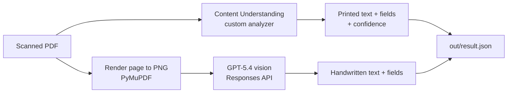

# Hebrew Document Extraction — Printed + Handwritten

Extract **printed Hebrew** *and* **handwritten Hebrew** from scanned documents using two
Azure AI engines together:

| Engine | Role |
| --- | --- |
| **Azure AI Content Understanding** | OCR of printed Hebrew + layout + structured field extraction, with confidence scores |
| **Azure OpenAI GPT vision** (`gpt-5.4`) | Reads Hebrew **handwriting** (which classic OCR does not support) and separates printed vs handwritten text |

The two outputs are merged side-by-side so you can compare how each engine read the document.

> **Why two engines?** Azure's deterministic OCR (Content Understanding / Document Intelligence)
> supports **printed** Hebrew but **not** Hebrew **handwriting**. A multimodal LLM (GPT vision)
> fills that gap. Content Understanding stays the reliable source for the printed form + fields;
> GPT recovers the handwritten values.

## Architecture



## Prerequisites

- Python 3.9+
- Azure CLI, logged in: `az login`
- Access (Entra ID RBAC) to:
  - a **Content Understanding** resource (`Cognitive Services User`)
  - an **Azure OpenAI** resource with a vision model deployment (`Cognitive Services OpenAI User`)

Authentication is **Microsoft Entra ID only** — no API keys are stored in the repo.

## Setup

```bash
pip install -r requirements.txt
az login
# optional: cp .env.example .env   and edit
```

## Usage

```bash
python extract_hebrew.py "sample/אישור מסירה -דירה 8.pdf"
```

Run Content Understanding only (skip GPT):

```bash
SKIP_GPT=1 python extract_hebrew.py "sample/אישור מסירה -דירה 8.pdf"
```

Higher-resolution render (better for faint handwriting):

```bash
RENDER_DPI=300 python extract_hebrew.py "sample/אישור מסירה -דירה 8.pdf"
```

## Output

Everything is written to the **`out/`** directory (git-ignored):

| File | Description |
| --- | --- |
| `out/result.json` | The merged, structured result (see schema below) |
| `out/page_N.png` | Each PDF page rendered to an image (also sent to GPT) |

`out/result.json` structure:

```jsonc
{
  "source_file": "sample/אישור מסירה -דירה 8.pdf",
  "content_understanding": {
    "markdown": "…full printed-Hebrew OCR of the form…",
    "fields": {
      "DocumentDate":    { "value": "2026-01-01", "confidence": 0.97 },
      "BuildingNumber":  { "value": "4",          "confidence": 0.97 },
      "ApartmentNumber": { "value": "8",          "confidence": 0.98 },
      "RecipientName":   { "value": null,         "confidence": 0.78 },
      "HandwrittenNotes":{ "value": null,         "confidence": 0.78 }
    }
  },
  "gpt_vision": [
    {
      "page": 1,
      "printed_text": "…",
      "handwritten_text": "…קיבלתי מזגן…",
      "fields": {
        "document_date": "…",
        "apartment_number": "8",
        "building_number": "4",
        "handwritten_notes": "…",
        "is_signed": true,
        "has_stamp": false
      },
      "uncertain": "words the model was unsure about"
    }
  ]
}
```

A short summary is also printed to the console after each run.

## Repository structure

```
.
├── extract_hebrew.py      # the pipeline (CU + GPT vision + merge)
├── requirements.txt       # Python dependencies
├── .env.example           # configuration template
├── .gitignore
├── sample/                # example input documents
└── out/                   # generated results (git-ignored)
```

## Notes & limitations

- **Handwriting is inherently ambiguous.** GPT may read an unclear date/name differently
  across runs. Treat GPT handwriting fields as *"needs review"*, especially where Content
  Understanding returns `null` or low confidence.
- **Sensitive data:** the sample documents and `out/result.json` can contain personal
  information (names, ID numbers). `out/` is git-ignored; review the `sample/` files before
  pushing this repo to any remote.
- Content Understanding requires model deployments (`gpt-4.1` / `gpt-4.1-mini` /
  `text-embedding-3-large`) configured as defaults on the resource.
