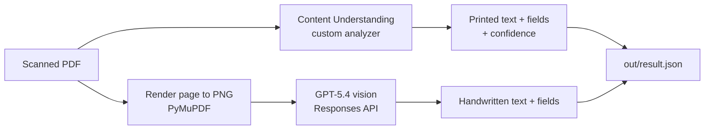

# Hebrew Document Extraction — Printed + Handwritten

Extract **printed Hebrew** *and* **handwritten Hebrew** from scanned documents using two
Azure AI engines together:

| Engine | Role |
| --- | --- |
| **Azure AI Content Understanding** | OCR of printed Hebrew + layout + structured field extraction, with confidence scores |
| **Azure OpenAI GPT vision** (`gpt-5.4`) | Reads Hebrew **handwriting** (which classic OCR does not support) and separates printed vs handwritten text |

The two outputs are merged side-by-side so you can compare how each engine read the document.

> **Why two engines?** Azure's deterministic OCR (Content Understanding / Document Intelligence)
> supports **printed** Hebrew but **not** Hebrew **handwriting**. A multimodal LLM (GPT vision)
> fills that gap. Content Understanding stays the reliable source for the printed form + fields;
> GPT recovers the handwritten values.

## Architecture



## Prerequisites

- Python 3.9+
- Azure CLI, logged in: `az login`
- Access (Entra ID RBAC) to:
  - a **Content Understanding** resource (`Cognitive Services User`)
  - an **Azure OpenAI** resource with a vision model deployment (`Cognitive Services OpenAI User`)

Authentication is **Microsoft Entra ID only** — no API keys are stored in the repo.

## Setup

```bash
pip install -r requirements.txt
az login
# optional: cp .env.example .env   and edit
```

## Usage

```bash
python extract_hebrew.py "sample/אישור מסירה -דירה 8.pdf"
```

Run Content Understanding only (skip GPT):

```bash
SKIP_GPT=1 python extract_hebrew.py "sample/אישור מסירה -דירה 8.pdf"
```

Higher-resolution render (better for faint handwriting):

```bash
RENDER_DPI=300 python extract_hebrew.py "sample/אישור מסירה -דירה 8.pdf"
```

## Output

Everything is written to the **`out/`** directory (git-ignored):

| File | Description |
| --- | --- |
| `out/result.json` | The merged, structured result (see schema below) |
| `out/page_N.png` | Each PDF page rendered to an image (also sent to GPT) |

`out/result.json` structure:

```jsonc
{
  "source_file": "sample/אישור מסירה -דירה 8.pdf",
  "content_understanding": {
    "markdown": "…full printed-Hebrew OCR of the form…",
    "fields": {
      "DocumentDate":    { "value": "2026-01-01", "confidence": 0.97 },
      "BuildingNumber":  { "value": "4",          "confidence": 0.97 },
      "ApartmentNumber": { "value": "8",          "confidence": 0.98 },
      "RecipientName":   { "value": null,         "confidence": 0.78 },
      "HandwrittenNotes":{ "value": null,         "confidence": 0.78 }
    }
  },
  "gpt_vision": [
    {
      "page": 1,
      "printed_text": "…",
      "handwritten_text": "…קיבלתי מזגן…",
      "fields": {
        "document_date": "…",
        "apartment_number": "8",
        "building_number": "4",
        "handwritten_notes": "…",
        "is_signed": true,
        "has_stamp": false
      },
      "uncertain": "words the model was unsure about"
    }
  ]
}
```

A short summary is also printed to the console after each run.

## Repository structure

```
.
├── extract_hebrew.py        # main pipeline (CU + GPT vision + merge)
├── handwriting_pipeline.py  # focused multi-pass handwriting OCR helper
├── requirements.txt         # Python dependencies
├── .env.example             # configuration template
├── .gitignore
├── sample/                  # example input documents
├── out/                     # extract_hebrew.py results (git-ignored)
├── output_handwriting/      # handwriting_pipeline.py results (git-ignored)
└── results/                 # <name>_results.jpg per document (git-ignored)
```

## Handwriting pipeline (`handwriting_pipeline.py`)

When handwriting is hard to read, this pipeline boosts accuracy by **not** relying on a
single OCR pass. Per handwriting region it:

1. **Detects** handwriting regions automatically (or takes manual crop boxes).
2. Creates several **enhanced image versions** (upscale+contrast, adaptive threshold,
   denoise, thickened strokes, horizontal-line removal) and **overlapping chunks**.
3. Sends every image to **GPT-5.4 vision** to transcribe *only* the handwriting — all calls
   run in parallel, with automatic retries so a timeout burst never drops a region.
4. **Visually adjudicates** the final reading: it re-shows the best images + all candidate
   readings to the model and lets it decide from the strokes (not a blind majority vote),
   returning per-word **confidence + a visual reason**. Falls back to text-only
   reconciliation, then to the best per-image reading.

It is **domain-agnostic** — no built-in vocabulary, no assumption about document type. You
can optionally pass a short **printed-text context** (from the Content Understanding output)
as a *soft* hint with `--printed-context-file` + `--context-mode nearby`; it never overrides
the visible strokes.

### How to test it

**Step 1 — auto-detect and transcribe everything (recommended):**

```bash
az login   # once
python handwriting_pipeline.py \
  --input "sample/אישור מסירה -דירה 8.pdf" \
  --auto-detect --ocr-mode full --workers 8 \
  --output ./output_handwriting/test
```

**Step 2 — inspect the outputs** (inside `--output`, git-ignored):

| File | What it is |
| --- | --- |
| `page_1_regions.png` | the page with numbered red detection boxes |
| `region_NN_*/result.json` | the region's final reading + per-word confidence/reason/notes |
| `region_NN_*/per_image_ocr.json` | what each enhanced image/chunk read |
| `region_NN_*/visual_reconcile_input.json` | images + candidates sent to the visual step |
| `region_NN_*/01_…`–`06_…`, `chunk_*.png` | the enhanced crops actually sent to GPT |
| `handwriting_result.json` | all regions combined |
| `merged.html` / `merged.jpg` | the page with extracted handwriting overlaid in **red** |
| `merged.md` | (with `--merge-md`) full doc: CU printed text + handwriting in red, de-duplicated |

**Other ways to run:**

```bash
# Manual crop(s) instead of auto-detect (repeat --crop per region):
python handwriting_pipeline.py --input "sample/doc.pdf" \
  --crop "180,1660,2050,260" --ocr-mode both --output ./output_handwriting/test

# No coordinates yet? Run with no crop to render the page, then read the pixel
# coords off page_1_render.png and re-run with --crop:
python handwriting_pipeline.py --input "sample/doc.pdf" --output ./output_handwriting/test

# Also build the merged Markdown (runs Content Understanding for the printed layer):
python handwriting_pipeline.py --input "sample/doc.pdf" --auto-detect --merge-md \
  --output ./output_handwriting/test

# Debugging: one call at a time so per-image outputs are easy to compare:
python handwriting_pipeline.py --input "sample/doc.pdf" --auto-detect --workers 1 \
  --output ./output_handwriting/test
```

**Batch — run all sample files, save `results/<name>_results.jpg`:**

```bash
mkdir -p results
for f in sample/*.pdf sample/*.png; do
  stem=$(basename "$f"); stem="${stem%.*}"
  python3 handwriting_pipeline.py --input "$f" --auto-detect --ocr-mode full \
    --workers 8 --output "output_handwriting/$stem"
  cp "output_handwriting/$stem/merged.jpg" "results/${stem}_results.jpg"
done
```

> **Tip:** run files **sequentially** (as above) or keep `--workers` modest so concurrent
> runs don't compete for the shared GPT quota — contention can cause 429s and empty regions.

### CLI options (`--help` for the full list)

- `--auto-detect` — locate all handwriting regions automatically
- `--crop "x,y,w,h"` — manual region in pixels (repeat for multiple regions)
- `--ocr-mode full|chunks|both` — which images to OCR (default `both`)
- `--workers N` — parallel GPT calls in flight (`1` for easy debugging)
- `--merge-md` — also build `merged.md` (CU printed text + handwriting, de-duplicated)
- `--printed-context / --printed-context-file` + `--context-mode none|nearby|summary` —
  optional short printed-text **soft** hint (default `none`)
- `--italic` — also read italic/cursive **printed** Hebrew here (opt-in only; normally
  italic is printed text and belongs to the Content Understanding pipeline)
- `--dpi`, `--page`, `--max-regions`

The handwriting engine is a Vision LLM — Tesseract is intentionally not used (weak for
Hebrew handwriting).

## Notes & limitations

- **Handwriting is inherently ambiguous.** GPT may read an unclear date/name differently
  across runs. Treat GPT handwriting fields as *"needs review"*, especially where Content
  Understanding returns `null` or low confidence.
- **Italic/cursive printed Hebrew is *printed*, not handwriting** — it belongs to the
  Content Understanding pipeline. The handwriting detector can occasionally over-detect
  italic script as handwriting; use `--italic` only as an opt-in when you want GPT to
  re-read italic (Content Understanding reads italic Hebrew less accurately).
- **Sensitive data:** the sample documents and generated results can contain personal
  information (names, ID numbers). `out/`, `output_handwriting/`, and `results/` are
  git-ignored; review the `sample/` files before pushing this repo to any remote.
- Content Understanding requires model deployments (`gpt-4.1` / `gpt-4.1-mini` /
  `text-embedding-3-large`) configured as defaults on the resource.
